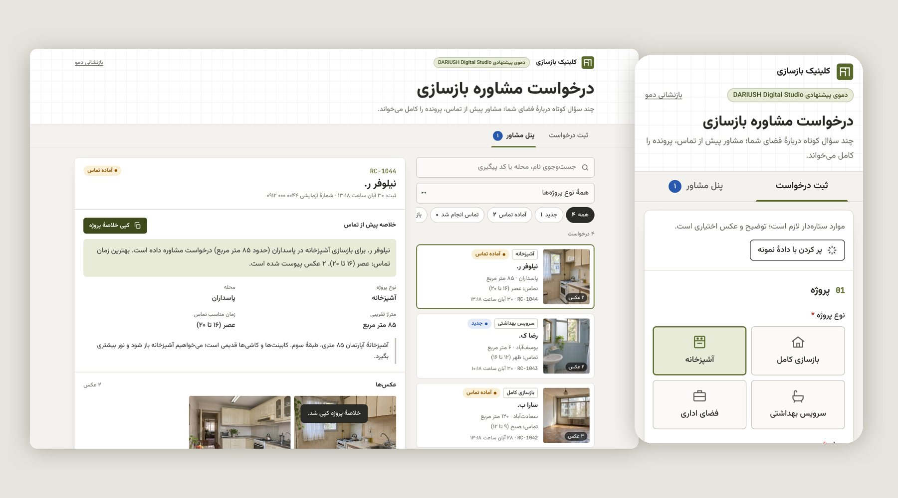

<div align="center">
  <h1>Renovation Consultation Request Demo</h1>
  <p><b>A Persian, right-to-left, phone-first web demo: a short consultation request form with a sample photo gallery and a tracking code, plus a consultant panel with search, filters, a pre-call case brief, notes and statuses.</b></p>
  <p>Proposal demo by <b>DARIUSH Digital Studio</b> for <b>Renovation Clinic</b> · all names, numbers, requests and photos are fictional samples</p>
  <p>
    <a href="https://dariush-tech.github.io/renovation-clinic-demo/"><b>Live demo</b></a> ·
    <a href="#demo-flow">Demo flow</a> ·
    <a href="#run-locally">Run locally</a>
  </p>
  <p>
    
    
    
    
    
  </p>
  
</div>

<div dir="rtl">

### خلاصه

دموی پیشنهادی DARIUSH Digital Studio برای کلینیک بازسازی. در تب «ثبت درخواست»، متقاضی نوع پروژه (بازسازی کامل، آشپزخانه، سرویس بهداشتی یا فضای اداری)، محله، متراژ تقریبی، نام نمایشی، شمارهٔ آزمایشی و زمان مناسب تماس را وارد می‌کند و در صورت تمایل توضیح کوتاه و تا سه عکس از گالری نمونه یا دستگاه خودش اضافه می‌کند. پس از ثبت، خلاصهٔ درخواست و کد پیگیری نمایشی نمایش داده می‌شود و «مشاهده در پنل مشاور» همان پرونده را باز می‌کند. در «پنل مشاور» سه درخواست نمونه، جست‌وجو بر اساس نام، محله یا کد پیگیری، فیلتر نوع پروژه و وضعیت، خلاصهٔ پیش از تماس، یادداشت، چهار وضعیت و «کپی خلاصهٔ پروژه» هست. همه‌چیز در localStorage همان مرورگر می‌ماند و هیچ پیام، تماس یا آپلودی انجام نمی‌شود.

</div>

## Demo flow

1. **Fill the sample.** «پر کردن با دادهٔ نمونه» fills a kitchen renovation for an 85 m² apartment in Pasdaran, with two gallery photos and an evening call window.
2. **Submit.** The summary shows every answer, the photos and a demo tracking code such as `RC-1044`.
3. **Open it in the panel.** «مشاهده در پنل مشاور» opens the same case: a one-paragraph brief to read before calling, the key facts, the customer's note and the photos.
4. **Work the case.** Switch the status between «جدید», «آماده تماس», «تماس انجام شد» and «بازدید هماهنگ شد», add a note, and copy the project summary.
5. **Reload.** Requests, notes and statuses are still there. «بازنشانی دمو» restores the three sample requests.

## Features

- **Short form in three numbered sections** (project, contact, description and photos) with inline Persian validation. Area and phone accept Persian or Latin digits; the phone must be an 11-digit test number and is never called.
- **Up to three optional photos** from an eight-photo sample gallery of pre-renovation spaces, or from the device. Device photos are resized in the browser for a local preview and are never uploaded.
- **Submit without photos** works the same way; cards and cases show a neutral placeholder.
- **Consultant panel** with request cards (type, status, neighbourhood, area, call window, photo count, tracking code), search by display name, neighbourhood or tracking code (Persian or Latin digits), a project-type filter and status chips with live counts.
- **Case file** with a pre-call brief, facts, customer description, photo lightbox, a four-state status switch, timestamped notes and a case history.
- **Copy project summary** produces Persian-first lines (tracking code, applicant, project type, neighbourhood, area, call window, description, photo count, status) that stay right-to-left in messaging apps.
- Persian calendar dates, a tab badge for new requests, light and dark themes, phone and desktop layouts, keyboard-accessible tabs and radio groups.

## Copied summary format

```
خلاصهٔ پروژه · کلینیک بازسازی (دمو)
کد پیگیری: RC-1044
متقاضی: نیلوفر ر.
نوع پروژه: آشپزخانه
محله: پاسداران
متراژ تقریبی: ۸۵ متر مربع
زمان مناسب تماس: عصر (۱۶ تا ۲۰)
توضیح: …
عکس‌ها: ۲ عکس
وضعیت: آماده تماس
```

## Project structure

```
renovation-clinic-demo/
├── index.html   # markup, styles, scripts and the eight sample photos (single file, no build step)
└── docs/        # README media
```

## Run locally

```bash
git clone https://github.com/dariush-tech/renovation-clinic-demo.git
cd renovation-clinic-demo
python3 -m http.server 8000
# open http://localhost:8000
```

## Notes

- The photos are sample images made for this demo, not projects or clients of Renovation Clinic.
- All requests, names and phone numbers are fictional and stay in each visitor's own browser.

---

Design & development: [Dariush Technology](https://github.com/dariush-tech) · DARIUSH Digital Studio
